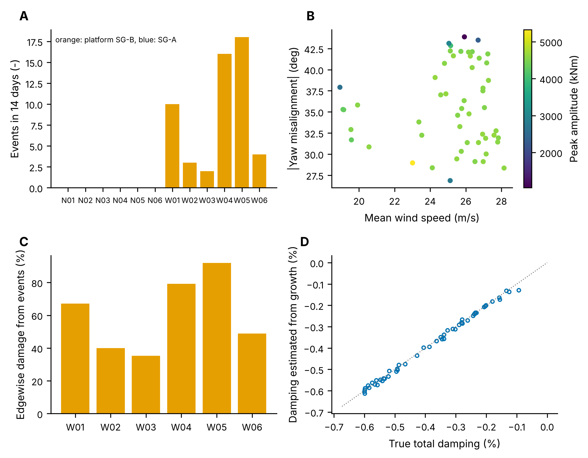
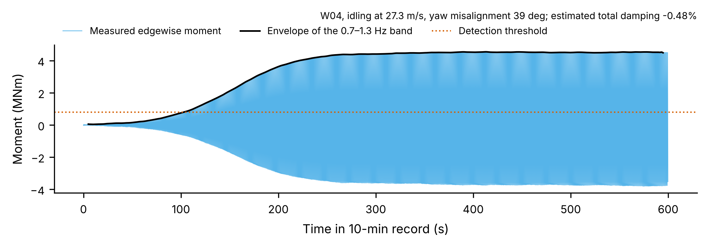
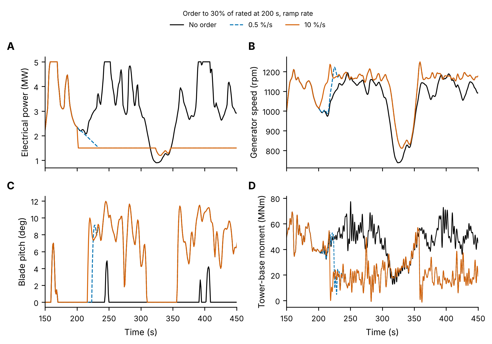
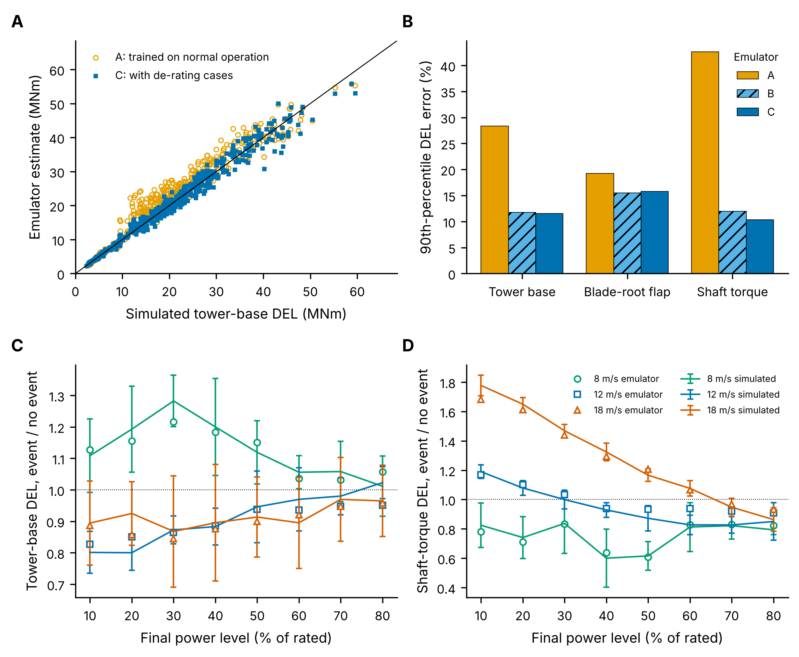
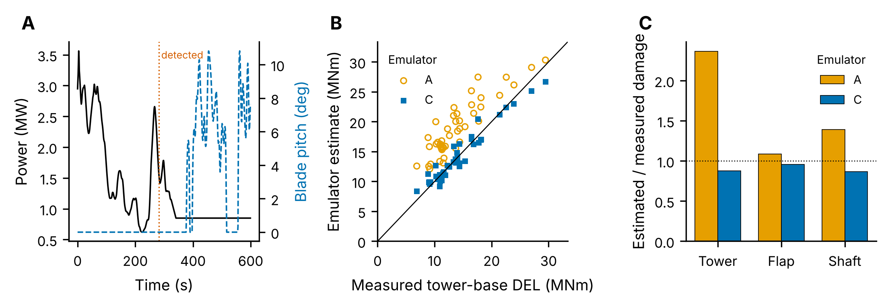
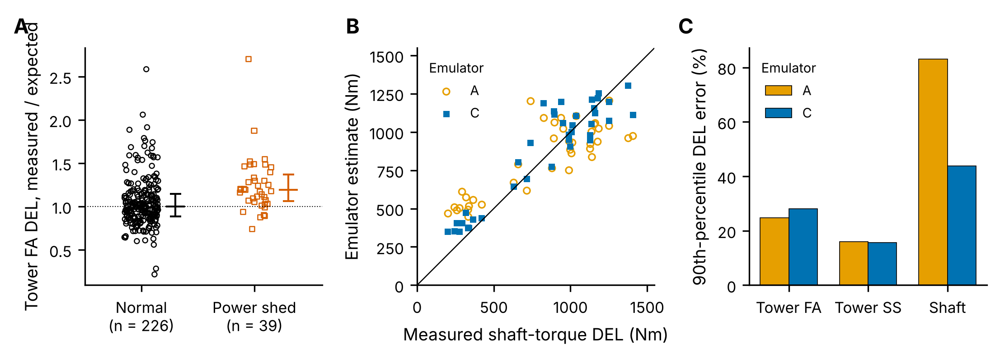

# Wind Fleet Monitoring: Edgewise Instability Detection, Fatigue Impact and KPIs

Two parts:

1. **Fleet monitoring** of one type of aeroelastic event, edgewise blade instability of idling turbines (steps 1-2 below).
2. **Load emulator for power de-rating transients** (`derating/`, steps 3-5): a reduced-order aero-servo-elastic turbine model, a simulation database, a machine-learning load emulator extended to commanded power reductions, and validation against field-like prototype data. See [Part 2](#part-2-load-emulator-for-power-de-rating-transients).
3. **Check on real measurements** (step 6): measured tower and shaft loads of a research turbine during frequency-control power shedding. See [Part 3](#part-3-check-on-real-measurements-bjorko-45-kw-turbine).

## Part 1: fleet monitoring

A reproducible fleet-analysis workflow for edgewise blade instability of idling turbines:

| Step | What it does |
|---|---|
| 1. Measurement database | 10-min SCADA statistics for 12 turbines on two platforms (14 days) in SQLite; 5 Hz blade-root edgewise moments served per record |
| 2. Data quality | Missing records, flat-lined sensors, lost samples, out-of-range wind and spikes are flagged or repaired before analysis |
| 3. Detection and features | Band-pass and envelope of the first edgewise mode; events with duration, peak amplitude, frequency, wind, yaw and state; total damping estimated from the growth of the oscillation |
| 4. Fatigue impact | Rainflow counting and Miner's rule (S-N slope 10 for glass-fibre blades); damage from events vs normal operation; prioritisation thresholds |
| 5. KPIs and reporting | Weekly summary, per-turbine KPIs and Power BI-ready tables, dashboard figure |
| 6. Integration | A JSON adapter with a fixed output schema for running the tool in a digital-twin service, and consistency tests against reference implementations |

```bash
pip install -r requirements.txt
python step1_build_database.py    # SQLite database with 23,846 10-min records
python step2_monitor_fleet.py     # about 2 min
python tests/test_tool.py         # or: python -m pytest -q tests

cd derating                       # Part 2
python step3_derating_database.py # 2,500 10-min simulations, about 1 min
python step4_train_emulator.py    # emulators A, B, C and sensitivity sweeps, about 2 min
python step5_field_validation.py  # one week of prototype data, event identification, comparison
python step6_bjorko_validation.py # real measurements (condensed file included in derating/data)
python make_figures.py
```

### The fleet model

Fleet data at this level of detail is not public, so a simple physical model plays the fleet (`fleet_sim.py`):

- **Fleet.** Two farms of six 4 MW turbines on two platforms. Platform SG-B has a blade with lower structural damping in the first edgewise mode (1.0 Hz).
- **Normal loading.** Gravity at the rotor frequency, plus the turbulent response of the edgewise mode.
- **Instability.** When a turbine idles in high wind (storms above cut-out, or grid curtailment) with a yaw misalignment around 20–50°, the aerodynamic damping of the edgewise mode turns negative. If the total damping is negative, the oscillation grows exponentially until it saturates in a limit cycle.
- **Sensor faults.** 1.5% of records missing, 1% flat-lined, 1% with lost samples, 5% with spikes, and some wind-sensor faults.

Because the true state of each record is known, detection, damping estimates and fatigue results can all be checked.

### Results (14 days, 12 turbines)

**Detection.** Of 54 instability events large enough to reach the 800 kNm threshold, 53 were detected, with no false alarms. A further 9 records were unstable but grew too slowly to cross the threshold within 10 minutes. The damping estimated from the growth of the envelope (logistic fit) matches the true total damping within 0.02 percentage points on average.

**Fatigue.** On platform SG-B, instabilities cover only **0.17% of the time but cause 62% of the edgewise fatigue damage**. An event 10-min record accumulates damage about 970 times faster than normal operation, because the high S-N slope weighs large cycles so heavily. Per turbine the event share ranges from 35% to 92%. Events are flagged high priority when they reach the limit cycle (peak above 4,000 kNm) or when one record does more damage than a week of normal operation.

**KPIs** (`results/kpi_turbine.csv`, `results/kpi_week.csv`, `results/fact_events.csv`): events and event hours per turbine and week, peak amplitudes, damage share, damage-equivalent load and data availability (95.6–96.8% of expected records usable). The tables are flat and keyed by turbine and time, ready for Power BI. `results/weekly_summary.md` is the generated weekly overview.



*A: events per turbine (none on platform SG-A). B: event conditions and peak amplitude. C: share of edgewise fatigue damage caused by events. D: total damping estimated from the measured growth vs the true value.*



### Integration and consistency checks

`twin_adapter.run()` takes a JSON payload (10-min statistics, signal, sampling rate) and returns JSON with a fixed schema, so the tool can be called by a digital-twin service without Python objects crossing the interface. `tests/test_tool.py` checks:

- rainflow damage against an independent ASTM E1049 implementation (equal to 1e-9);
- the damping estimate on a known instability (within 15%);
- that the adapter reproduces the direct call exactly, with every schema key present;
- that the quality checks catch flat-lined, truncated and out-of-range records.

### SQL

`db.py` holds parameterised query functions: records by period, farm, state and minimum wind, weekly event counts joined with SCADA, and availability per turbine. The same queries would translate directly to KQL on a time-series store.

### Limitations

- The fleet and signals are synthetic: one edgewise mode, a simple aerodynamic-damping map, no aeroelastic solver. Real events also include vortex-induced vibrations and stall-induced vibrations in operation.
- Fatigue is evaluated on the blade-root edgewise moment only, with a single S-N slope and relative damage units, not certified load cases.
- Detection uses a fixed threshold; on real data it would be tuned per platform, and machine learning could classify event types.

### Repository layout

```
fleet_sim.py              synthetic fleet: SCADA, edgewise dynamics, instability model
db.py                     SQLite database and SQL query functions; signal access with sensor faults
monitoring.py             quality checks, despiking, detection, features, rainflow fatigue
twin_adapter.py           JSON interface for digital-twin integration
step1_build_database.py   builds the database
step2_monitor_fleet.py    fleet run, detection check, fatigue, KPIs, weekly summary, figures
tests/test_tool.py        consistency tests
```

## Part 2: load emulator for power de-rating transients

Wind turbines take part more and more in balancing and ancillary-service markets, so operators command power reductions (de-ratings) far more often than before. A load emulator trained only on normal operation does not know what such a transient does to the structure. This part extends a machine-learning load emulator so it can estimate fatigue loads during de-rating events, and checks it against measurements from a prototype.

| Step | What it does |
|---|---|
| Rotor aerodynamics | Blade element momentum (Prandtl tip and hub losses, Glauert/Buhl correction) on the NREL 5 MW blade geometry; Cp, Ct and blade-root flap tables over tip-speed ratio and pitch (`bem.py`) |
| Aero-servo-elastic model | Rotor speed and first tower fore-aft mode, aerodynamics evaluated with the wind relative to the moving tower top (so aerodynamic damping is captured), turbulent rotor-effective wind (Kaimal); baseline controller with region 2.5, constant power above rated and a gain-scheduled PI pitch loop tuned by pole placement to this rotor; an operator power reference that ramps down from the current output (`turbine.py`) |
| Simulation database | 1,000 normal-operation and 1,500 de-rating cases sampled over wind speed (4-25 m/s), turbulence (IEC NTM), shear, initial and final power and ramp rate (0.2 to 20 % of rated per second); 10-min SCADA statistics and transient descriptors as inputs, 1 Hz damage-equivalent loads (DEL) of tower base (m = 4), blade-root flap (m = 10) and shaft torque (m = 4) as targets (`database.py`, step 3) |
| Emulator | Gradient-boosted trees on log DEL (`mlle.py`). **A**: trained on normal operation only. **B**: with de-rating simulations. **C**: with de-rating simulations and transient features (power drop, steepest ramp, pitch rate, overspeed) |
| Sensitivity | Controlled sweeps of ramp rate and initial and final power at 8, 12 and 18 m/s with common turbulence seeds; simulated vs emulated DEL ratio (step 4) |
| Field validation | One week (1,008 records) from a stand-in prototype the emulator has never seen: softer, better-damped tower, 3% lower rotor efficiency, retuned pitch gains, an anemometer reading 4% low and strain-gauge calibration errors; grid-service orders (curtailment, aFRR, fast frequency reserve); events identified from SCADA alone; measured vs estimated DEL and fatigue damage (step 5) |

### Results

**A de-rating changes the load picture, and in different directions.** Below rated wind (8 m/s), a reduction pushes the rotor to rated speed and the pitch loop takes over, so the tower is regulated by pitch and loses some aerodynamic damping: tower-base DEL rises by up to about 25%. At 12 and 18 m/s the lower thrust reduces tower DEL by 10-20%. The shaft is the opposite: at 18 m/s the torque step itself is one large cycle, so a deep reduction (to 10% of rated) raises shaft DEL by about 80%. Within 10-min records, the ramp rate (0.2-20 %/s) changed DELs much less than the depth of the reduction and the wind speed; its main effect is on peak tower moment.

**The emulator needs to have seen transients.** On held-out de-rating simulations:

| Emulator | Tower base, p90 error | Blade flap, p90 error | Shaft, p90 error |
|---|---|---|---|
| A: normal operation only | 28% | 19% | 43% |
| B: + de-rating simulations | 12% | 16% | 12% |
| C: + transient features | 12% | 16% | 10% |

In the sweeps, emulator C reproduces the simulated sensitivity to final power level and wind within a median 2-3%.

**Field validation.** Of 51 effective de-ratings in the prototype week, 46 were identified from power, pitch and rotor speed alone with no false alarms (precision 1.00, recall 0.90); the 5 missed events start late in a record and would be caught in the following one on continuous data. On the identified event records:

| | Tower base | Blade flap | Shaft |
|---|---|---|---|
| Median DEL error, emulator A | 38% | 9% | 10% |
| Median DEL error, emulator C | 6% | 5% | 6% |
| Estimated / measured damage, A | 2.36 | 1.08 | 1.39 |
| Estimated / measured damage, C | 0.88 | 0.95 | 0.87 |

Emulator A overestimates tower damage during de-ratings by more than a factor of two, because it reads the pitched, high-speed state as a high-wind condition. Emulator C stays within about 13% on damage, with the remaining bias coming from the prototype-model differences (the stand-in for real model error).



*Same turbulent wind at 10 m/s, order to 30% of rated at 200 s. A: power; B: generator speed; C: pitch; D: tower-base fore-aft moment.*



*A: emulator estimates on held-out de-rating simulations. B: 90th-percentile error by emulator. C, D: DEL ratio (event / no event) vs final power level, simulation (lines, mean and SD over 6 seeds) and emulator C (markers).*



*A: an identified event in the prototype data. B: measured vs estimated tower DEL on event records. C: estimated over measured fatigue damage on event records.*

### Limitations and next steps

- **Not OpenFAST.** Two structural degrees of freedom, quasi-steady BEM tables (no dynamic inflow or dynamic stall), rigid blades and drivetrain, rotor-effective wind instead of a full turbulence box, generic aerofoil polars (Cp max 0.46 vs 0.48 for the NREL 5 MW). The next step would be to generate the database with OpenFAST or the in-house tool and keep the same pipeline.
- **The prototype is simulated.** It is the same model with changed parameters, so it tests robustness to model error, not to physics the model lacks. Part 3 adds a check on real measurements.
- **Blade flap with m = 10** is dominated by a few high-wind records, and wind shear is not visible in nacelle SCADA, so flap damage on the simulated test set is underestimated (ratio 0.55). Tail-weighted training or a shear estimate (met mast, lidar or blade-load asymmetry) would help.
- **Restorations** (ramping back up) and repeated orders in one record are not yet included.

### Files (`derating/`)

```
bem.py                      BEM rotor model and steady Cp, Ct, flap tables
turbine.py                  reduced-order aero-servo-elastic model and controller, vectorised
database.py                 case sampling, SCADA features, transient descriptors, DEL targets
mlle.py                     load emulator (gradient-boosted trees) and scoring
step3_derating_database.py  simulation database
step4_train_emulator.py     emulators A, B, C and sensitivity sweeps
step5_field_validation.py   prototype week, event identification, measured vs estimated loads
make_figures.py             figures 3-5
../tests/test_derating.py   power curve, order tracking and event identification checks
```

## Part 3: check on real measurements (Björkö 45 kW turbine)

Simulated "field" data can only test robustness to model error. To test the method on physics the model does not contain, I used the open high-frequency dataset of the Chalmers research turbine on Björkö, Sweden (45 kW, 30 m wooden tower, 20 Hz, CC BY 4.0; Fogelström et al., Zenodo, [doi:10.5281/zenodo.8230330](https://doi.org/10.5281/zenodo.8230330)). During the campaign the turbine ran frequency-control tests (FCR-N, FCR-D) and manual power shedding, and the controller logged the power it removed (`Pwaste`), next to calibrated tower-base moments and a shaft-torque strain gauge.

`tools/prepare_bjorko.py` condenses the 2.8 GB file into 10-min records (SCADA statistics, logged control signals, transient descriptors and 1 Hz DELs of tower fore-aft and side-side moments, rotated with the yaw angle, and shaft torque). It ran on a GitHub Actions runner (`tools/bjorko_github_workflow.yml`); the condensed file is `derating/data/bjorko_10min.csv.gz`. After filtering, 265 running records (44 hours on 34 days) remain, 39 of them with power shedding on 7 days. All model tests use leave-one-day-out cross-validation.

**Results**

- **Power shedding raised tower fore-aft fatigue.** Compared with the DEL expected from the mast wind speed and turbulence alone, shedding records had a median tower fore-aft DEL 19% higher (normal records: 0%). The simulations of Part 2 predicted the same direction below rated wind, where a reduction hands control of rotor speed to the pitch loop (about +25%). Side-side and shaft DELs did not change in the median.
- **Emulator trained on normal operation only (A) vs with shedding records and set-point features (C)**, on the shedding records:

| | Tower FA | Tower SS | Shaft torque |
|---|---|---|---|
| Median DEL error, A / C | 11% / 9% | 6% / 7% | 20% / 12% |
| 90th-percentile error, A / C | 25% / 28% | 16% / 16% | 83% / 44% |
| Estimated / measured damage, A / C | 0.34 / 0.41 | 0.98 / 0.91 | 0.71 / 1.00 |

  The clearest gain is on the shaft, where emulator A overestimated the low-load shedding records of one day by up to 130%. The tower fore-aft damage is underestimated by both, because one shedding record (8.7 m/s mast wind, constant 5 kW shed) has a DEL nearly twice as high as any other record; with 39 shedding records on 7 days, such cases cannot be learned.
- **The SCADA-only detection rule of Part 2 does not transfer.** This turbine regulates rotor speed with pitch already at moderate wind, so pitch activity below rated is common in normal operation: the rule found 27 of 39 shedding records but raised 64 false alarms. On a real platform the operator set-point is logged and should be used directly; a SCADA-only detector has to be tuned to the controller of each platform.



*A: tower fore-aft DEL relative to the value expected from ambient wind, normal vs power-shed records (median and interquartile range). B: shaft-torque DEL on shedding records, measured vs estimated. C: 90th-percentile DEL error on shedding records.*

**Limits.** A 45 kW turbine with a wooden tower is far from a multi-megawatt platform, the shedding tests cover 7 days, and the blade-root strain gauges in this dataset are uncalibrated, so blade loads are not used.
